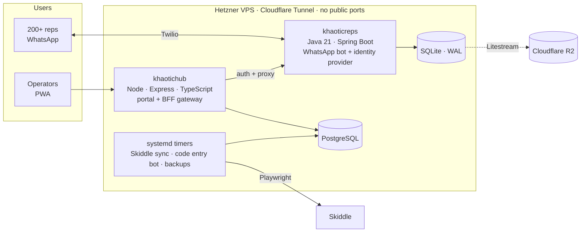

<div align="center">

# Alex Beattie

**Software Engineer · Final-year SE @ Strathclyde · ex-BAE Systems · Co-founder, Khaotic Events**

*I build systems that real people depend on, then keep them running.*

<br/>

[](https://www.linkedin.com/in/alexanderbeattie04/)
[](mailto:alexbeattie04@gmail.com)
[](https://khaotic.uk)

</div>

---

```text
> status      final year, graduating May 2027
> seeking     forward-deployed / client-facing engineering roles, summer 2027
> placement   BAE Systems, Jun 2025 - Jun 2026, rated "Exceeds Expectations"
> building    Khaotic OS, in production 24/7
> location    Glasgow, Scotland
```

<div align="center">


</div>

---

## Khaotic OS / Hub

The operations platform behind a UK harder styles & techno promoter. **Solo build, in production 24/7**, replacing spreadsheets as the system of record for ticketing, finance and a rep sales network**.



| | |
|---|---|
| **Rep engine** | Self-serve discount codes, live stats, leaderboards and automated recruitment over WhatsApp |
| **Attribution** | Skiddle API plus portal automation match ~2,900 orders to individual reps for per-event P&L and payouts |
| **Ops** | Role-based access across six roles, web push, Litestream replication with a tested restore, nightly backups, pre-deploy checks |

<sub>Production code is private. Happy to walk through the architecture in an interview.</sub>

---

## 🛰️ BAE Systems · Software Engineer, Industrial Placement

| Project | What I did | Stack |
|---|---|---|
| Full-stack internal platform | Owned the frontend, designed the schema, built the API | Angular, Node.js, PostgreSQL |
| Distributed cost metrics | Took over a legacy codebase, extended it inside an HLA simulation | Java, REST, HLA |
| DSEI UK 2025 | Simulation scenarios demonstrated live at the UK's largest defence exhibition | VBS, SQF |
| 3D interior editor | Self-directed: multi-floor buildings generated from OpenStreetMap data | Godot, C# |

<sub>Placement work was on internal systems, so it doesn't appear on this profile.</sub>

---

<div align="center">


<sub>Currently: dissertation on digital twins of commodity supply chains · No-Gi BJJ blue belt · skiing</sub>

</div>
