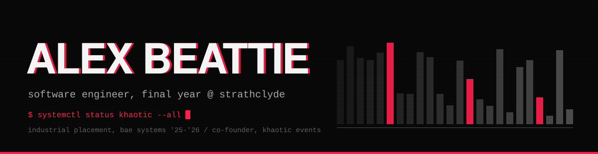
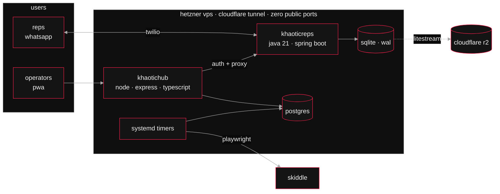

<p>
  <a href="https://www.linkedin.com/in/alexanderbeattie04/"><code>linkedin</code></a>&nbsp;
  <a href="mailto:alexbeattie04@gmail.com"><code>email</code></a>&nbsp;
  <a href="https://khaotic.uk"><code>khaotic.uk</code></a>
</p>

Final-year Software Engineering at Strathclyde. A year at BAE Systems. Co-founder of a Glasgow harder styles collective running events across the UK, and the engineer behind the software it runs on.


&nbsp;

### `01` &nbsp;khaotic os

We went from 130-capacity club nights to selling out the O2 Academy Glasgow, and the spreadsheets didn't survive the trip. Khaotic OS is what replaced them. I built it on my own, it runs 24/7, and if it goes down on launch day I hear about it from the other founders and 200 reps at once.



A few things I'm quietly pleased with:

- **The bot is the login system.** Reps already live in WhatsApp, so the Java bot that hands out their discount codes is also the identity provider the portal authenticates against. One less system to keep alive.
- **Skiddle's API doesn't tell you which discount code each order used.** So a Playwright job logs into the promoter portal and reads it, which lets us attribute ~2,900 orders to the rep who sold them.
- **I've actually restored the backup.** Litestream streams SQLite to R2. I ran the restore drill before I needed it.

<sub>code's private. happy to go through it properly.</sub>

&nbsp;

### `02` &nbsp;industrial placement, bae systems '25-'26

Year-long placement. Rated *Exceeds Expectations* and assessed as working above placement level.

- Built the frontend, schema and API for an internal full-stack platform (Angular, Node, Postgres)
- Inherited a Java metrics service and got it running inside an HLA distributed simulation
- Built simulation scenarios in VBS that were shown live at **DSEI 2025**
- On my own time, a Godot (C#) editor that turns OpenStreetMap data into walkable multi-floor buildings with internal building editor.

<sub>all internal, so none of it lives here.</sub>

&nbsp;

### `03` &nbsp;stack

```
java · spring boot · typescript · node · angular · postgres · sqlite
docker · linux · systemd · cloudflare · playwright · godot
```

&nbsp;

<sub>writing a dissertation on digital twins of commodity supply chains. otherwise on a bjj mat or a mountain.</sub>
